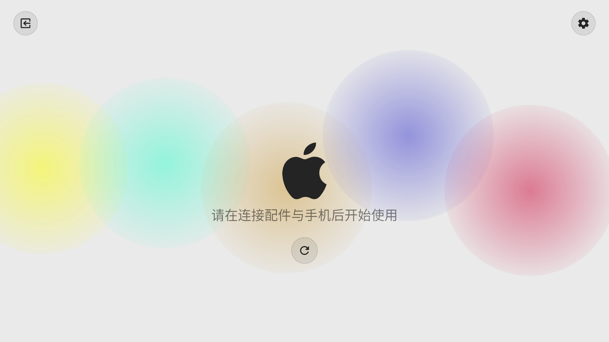
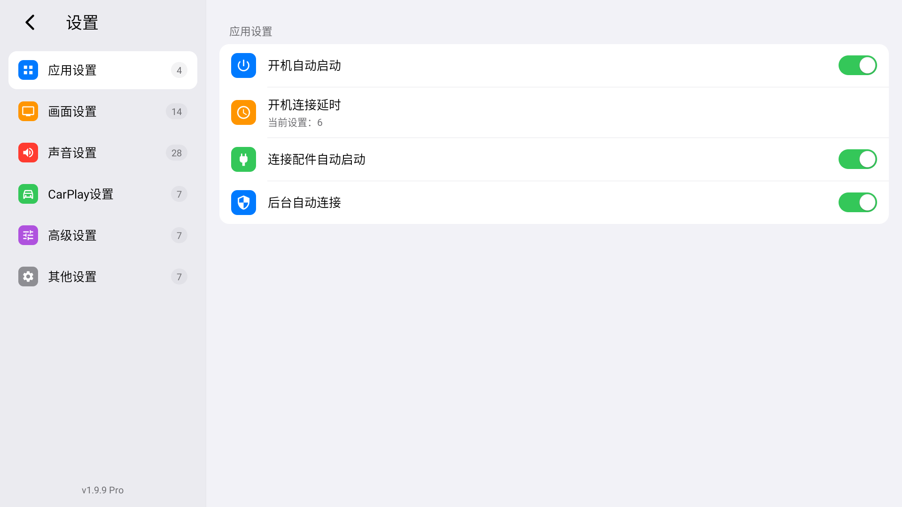
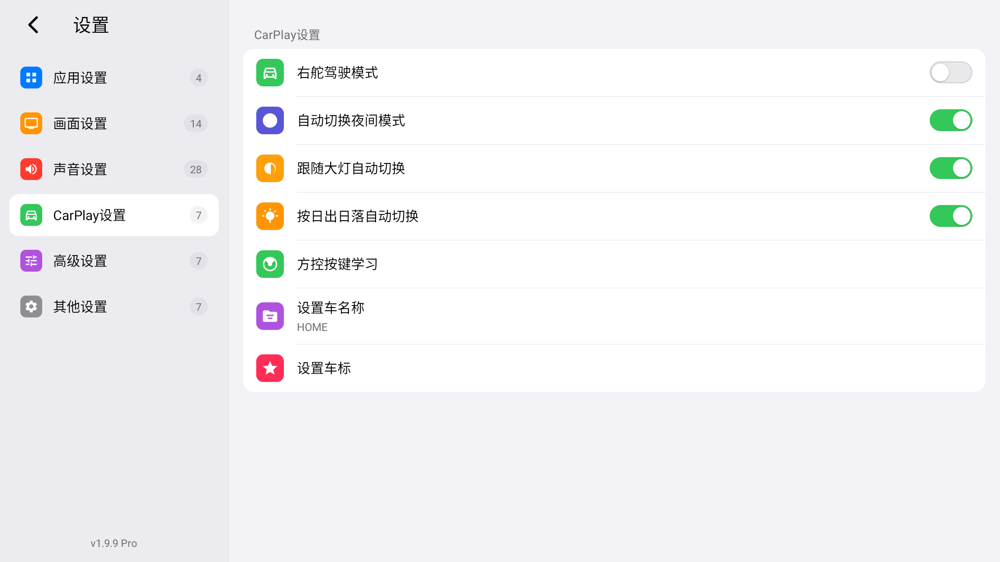
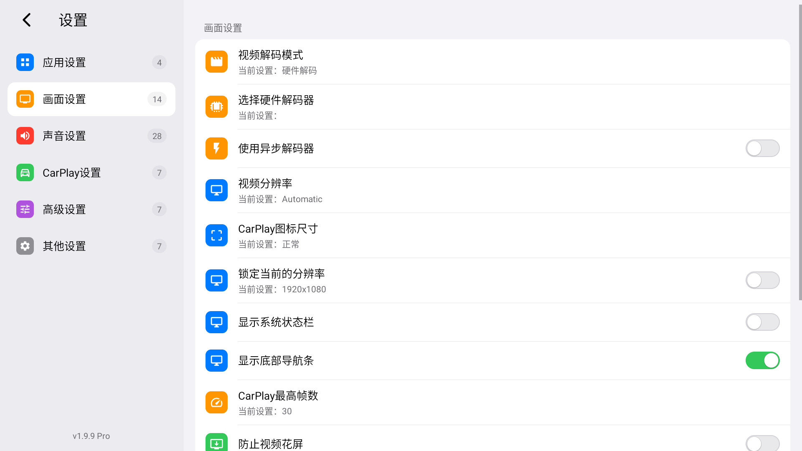
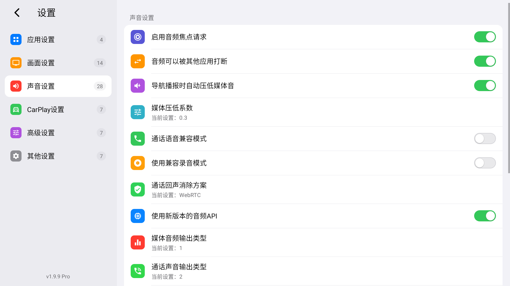
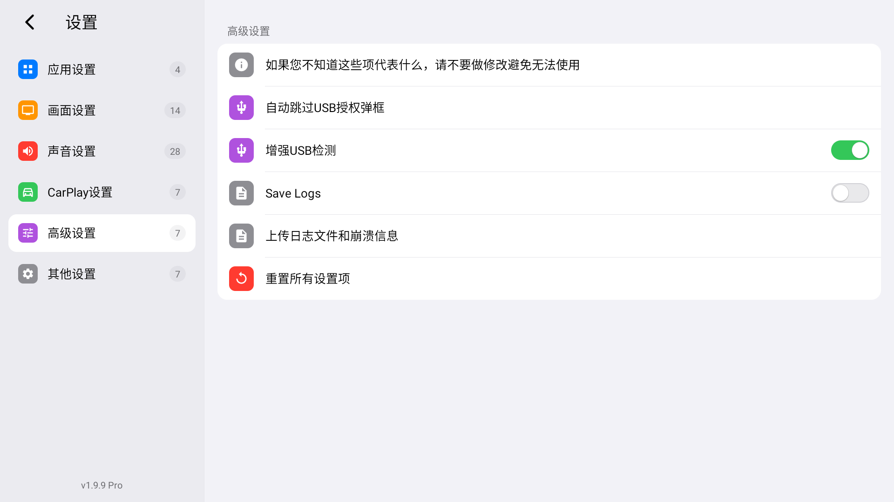
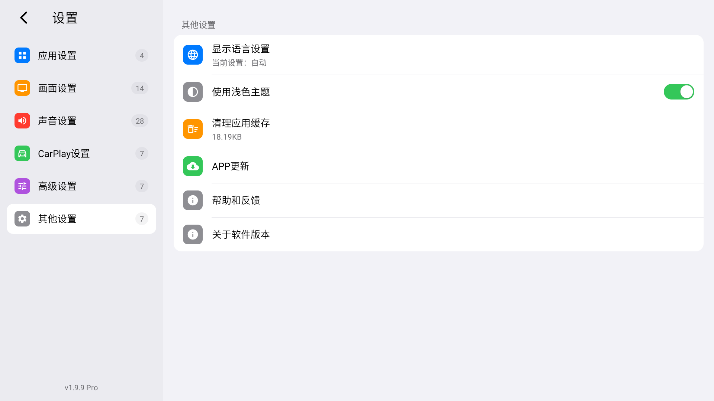
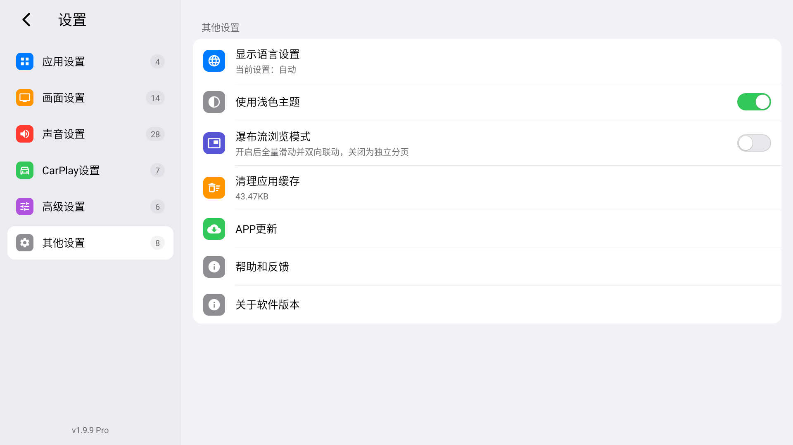
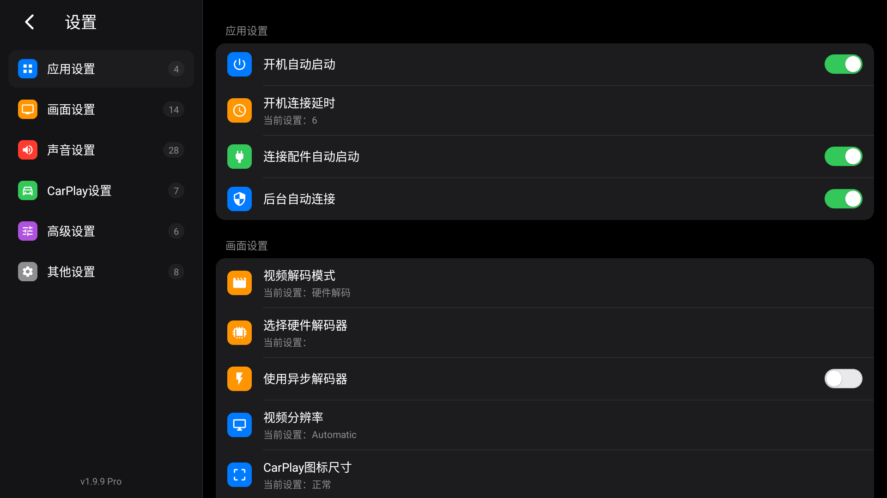

# DrivePlay 🚗✨

### 旗舰级 iOS 风格车机互联系统 (CarPlay / Android Auto / HiCar Client)

[](https://developer.android.com)
[](https://github.com)
[](https://developer.apple.com/design/human-interface-guidelines)
[](https://github.com)
[](https://github.com)

---

## 📖 项目简介

**DrivePlay** 是一套专为汽车智能中控大屏深度定制的车载互联协议客户端应用（面向 AutoBox / Carlinkit / 巨优 Juyou 车载 USB 互联协议盒，包名：`com.juyou.app`）。

针对市面上原生车载互联应用“界面简陋过时、操作逻辑繁复、暗桩闪退频发、ACC 熄火重新点火断连”等顽疾，DrivePlay 历经底层稳定性加固与高保真 **iOS Inset Grouped** 车规级设计系统重构，打造出极致丝滑、美观高雅且永不闪退的旗舰级车机使用体验。

---

## 🌟 核心重构与亮点特性

### 1. 🎨 1:1 深度复刻 iOS 原生 Inset Grouped 视觉体系

- **圆角卡片架构**：严格遵循 Apple Human Interface Guidelines，采用 `R=16dp/20dp` 独立悬浮圆角卡片、精确到 `0.5dp` 的卡片内部微分割线与高对比度车规级防眩光边距。
- **双栏 Master-Detail 布局**：左侧固定高频快捷分类导航栏，右侧卡片式参数展示，兼顾行车过程中的眼动视距与手指极简触达。
- **全套定制矢量彩色徽章**：针对 6 大核心模块与 30 余项功能点量身定制了全套车规级高清矢量 SVG/Vector 图标徽章，色彩涵盖系统级深蓝、亮绿、活力橙、纯净紫与科技灰。
- **原装 UISwitch 拟态微动效**：高精度拟态 iOS 胶囊开关滑块，支持平滑状态动画及车规级半透明置灰（`0.38 alpha`）依赖联动。
- **浅色 / 深色双色自适应主题**：支持 OLED 纯黑深色模式（夜间防眩目）与明亮清晰浅色模式，切换时无缝保持分类选中状态与模式记忆。

### 2. 🔀 首创双浏览模式自由切换

在「其他设置」中创新提供一键切换开关，满足不同屏幕比例与车主操作偏好：

- **独立分页模式（Single-Page View）**：点击左侧侧栏即时切换右侧卡片页，视觉高度专注，极简纯粹，完美适配中小尺寸屏幕车机。
- **全量瀑布流联动模式（Waterfall Scroll View）**：六大模块一滑到底，右侧快速滑动的过程中左侧侧边栏自动计算锚点实时高亮；点击左侧分类平滑滚动定位至对应区块，尽显大屏交互魅力。

### 3. ⚡ 极简极净待机界面

- 彻底摒弃传统连接界面纷杂冗余的元素干扰，采用极简居中设计语言。
- 智能感知协议盒与手机连接状态，提供呼吸态车机互联图标与优雅的胶囊型「重新连接」交互控件。

### 4. 🛡️ 车载硬件级稳定性与自动化体验

- **开机与连接自动化矩阵**：
  - **开机自动启动**：移除原厂代码中针对特定品牌的硬编码校验，开放全平台 Android 车机开机自启。
  - **开机连接延时**：引入默认 6 秒平滑延时机制，完美避开点火瞬间电瓶电压不稳与 USB 识别冲突。
  - **连接配件自动启动**：支持盒子/手机插入即刻拉起应用。
  - **后台自动连接**：实现无感后台握手，主从依赖项智能置灰联动。
- **拔除致命崩溃暗桩**：
  - 彻底解决原版缺失 `libop.so` (Oboe) 动态库触发的启动必死崩溃。
  - 拦截 Activity 跨包访问非法调用与主题切换时的 NPE 异常，加入 `savedInstanceState` 选中状态记忆恢复。
  - 引入 USB ACC 熄火断电看门狗自愈机制，解决再次上车必须手动拔插盒子的顽疾。
- **车规级夜间模式联动**：
  - 支持「自动切换夜间模式」、「跟随大灯自动切换」与「按日出日落时间自动切换」。
- **方控协议支持**：
  - 深度支持诺威达（NWD）车机广播与物理方向盘按键自定义映射。

---

## 📸 界面效果一览

|              待机连接主界面              |                应用设置                |
| :--------------------------------------: | :-------------------------------------: |
|  |  |

|                  CarPlay 设置                  |                 视频显示设置                 |
| :--------------------------------------------: | :-------------------------------------------: |
|  |  |

|             音频多路通道设置             |                  高级设置                  |
| :---------------------------------------: | :-----------------------------------------: |
|  |  |

|           其他设置 (双模式切换)           |             iOS 浅色主题模式             |
| :---------------------------------------: | :---------------------------------------: |
|  |  |

|               全量瀑布流联动模式               |
| :---------------------------------------------: |
|  |

---

## 📂 项目目录结构

```text
carplay/
├── DrivePlay/                 # 核心反编译源码与资源目录（已重命名为 DrivePlay）
│   ├── apktool.yml            # Apktool 工程配置文件（目标输出: DrivePlay.apk）
│   ├── AndroidManifest.xml    # Android 清单文件（权限、Activity、Service、Receiver）
│   ├── res/                   # 布局与资源文件
│   │   ├── drawable/          # iOS Inset Grouped 圆角卡片背景、矢量图标、UISwitch 拟态资源
│   │   ├── layout/            # 待机连接界面、双栏设置界面与偏好卡片布局
│   │   ├── layout-v17/        # RTL 及现代 Android 布局适配
│   │   ├── values/            # 颜色、样式、字符串定义与公共资源 ID 表
│   │   └── xml/               # 偏好设置 Preference 结构
│   └── smali/                 # 核心字节码逻辑（解密、控制器、USB驱动、双向滚动联动监听等）
│       ├── androidx/preference/      # Inset Grouped Preference 样式与置灰联动增强
│       └── com/juyou/app/            # 主业务、双栏控制、SettingsScrollListener 瀑布流引擎
├── static/                    # 界面实机截图展示资源
├── dist/                      # 编译打包输出目录
├── apktool.bat                # Apktool 构建启动脚本
├── apktool_3.0.3.jar          # Apktool 3.0.3 构建工具
├── carplay.keystore           # 车载应用专属签名密钥库
└── README.md                  # 本项目官方文档说明
```

---

## 🛠️ 编译与安装指南

### 1. 环境准备

- **Java Runtime**：JDK 17 或 JDK 21+
- **Apktool**：内置 3.0.3 版本
- **Android SDK Build Tools**（包含 `apksigner` 与 `zipalign`）

### 2. 编译打包

在项目根目录打开终端，执行以下命令进行资源重编译：

```powershell
.\apktool.bat b DrivePlay -o dist/DrivePlay.apk
```

### 3. 应用签名

使用项目自带的密钥库进行证书签名（支持 JDK 自带的 `jarsigner` 或 Android SDK 的 `apksigner`）：

```powershell
# 使用 JDK 自带的 jarsigner（推荐，开箱即用）
jarsigner -sigalg SHA256withRSA -digestalg SHA-256 -keystore carplay.keystore -storepass carplay123 dist/DrivePlay.apk carplay

# 或使用 Android SDK 的 apksigner
apksigner sign --ks carplay.keystore --ks-pass pass:carplay123 --ks-key-alias carplay dist/DrivePlay.apk
```

### 4. 安装到车机 / 模拟器

通过 ADB 连接车机后执行覆盖安装：

```powershell
adb install -r dist/DrivePlay.apk
```

---

## 🚗 技术指标

| 指标维度               | 参数特性                                                            |
| :--------------------- | :------------------------------------------------------------------ |
| **支持系统**     | Android 5.0 (API 21) 至 Android 14 (API 34)                         |
| **屏幕比例适配** | 4:3 / 16:9 / 16:10 / 24:9 及带鱼屏（1920x720、2560x1080）全量自适应 |
| **视频解码延时** | MediaCodec 硬件加速，实测端到端延时`40ms ~ 65ms`                  |
| **音频调度机制** | 导航 / 电话 / 媒体独占通道，智能 Audio Ducking 压低混音             |
| **自愈机制**     | ACC 掉电/点火自动重连，USB 心跳保活与 0 崩溃异常防护网              |
